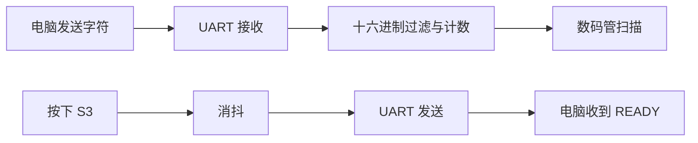

# FPGA Serial Workbench

基于 Verilog 的 FPGA 串口工作台。主项目把电脑发来的十六进制字符显示在 Minisys 的八位数码管上，并支持通过板载按键回发消息。仓库提供八个可独立构建的顶层，从加减器、寄存器和流水灯逐步扩展到 UART 收发和关键词识别。

## 串口监视器演示

烧录 `uart_hex_monitor` 后，按 S1 复位。打开板载 USB-UART 对应的串口，选择 **9600 baud、8N1、无流控**，以 ASCII 文本发送。

| 操作 | 预期结果 |
| --- | --- |
| 发送 `12Ab3cD` | 数码管显示 `2Ab3Cd07`。左六位是最近收到的有效字符，右两位 `07` 是累计计数。 |
| 按一下 S3 | 电脑收到一行 `READY`，以 CRLF 结束。 |

监视器只计入 `0–9`、`A–F` 和 `a–f`。左侧未填满的位置保持熄灭，右侧计数在 `99` 后回到 `00`。



## 快速开始

### 软件仿真

安装 Python 3 和 Icarus Verilog，并将 `iverilog` 和 `vvp` 加入 `PATH`。 [Icarus Verilog 下载与文档](https://steveicarus.github.io/iverilog/)

```sh
git clone https://github.com/monesy231/fpga-serial-workbench.git
cd fpga-serial-workbench
python scripts/simulate.py
```

9 组自检全部通过时输出 `Passed 9 simulations.`。单独运行监视器并保存波形时使用下列命令，输出文件为 `build/sim/tb_uart_hex_monitor.vcd`。

```sh
python scripts/simulate.py uart_hex_monitor --vcd
```

### Minisys 上板

使用带 Artix-7 器件支持的 Vivado。目标器件是 `xc7a100tfgg484-1`，板载时钟为 100 MHz。在仓库根目录运行以下构建命令。

```sh
vivado -mode batch -source scripts/build_minisys.tcl -tclargs uart_hex_monitor
```

比特流 `uart_hex_monitor.bit`、时序报告和资源报告生成在 `build/vivado/uart_hex_monitor/`。将命令末尾替换成下表中的顶层名即可构建其他设计。JTAG 下载与板上操作见 [Minisys 使用指南](docs/minisys.md)。

## 设计索引

| 可构建顶层 | 功能 |
| --- | --- |
| [`add_sub_mux`](rtl/basics/add_sub_mux.v) | 带使能的 4 位加减选择 |
| [`dff`](rtl/basics/dff.v) | 带使能和异步清零的 D 触发器 |
| [`reg8file`](rtl/basics/reg8file.v) | 支持同步写入、异步读取的 8×8 寄存器组 |
| [`led_chaser`](rtl/basics/led_chaser.v) | 四档速度、按键启停、双向循环移位 |
| [`display_demo`](rtl/apps/display_demo.v) | 对比消抖前后的按键计数，同时显示 0–30 定时计数 |
| [`uart_beacon`](rtl/apps/uart_beacon.v) | 通过 UART 周期发送 `HELLO FPGA` |
| [`uart_hex_monitor`](rtl/apps/uart_hex_monitor.v) | 六位十六进制滚动显示与按键回发 |
| [`uart_keyword_console`](rtl/apps/uart_keyword_console.v) | 识别 `start`、`stop` 和 `fpga`，收到行尾后回复匹配代码 |

- 时序公式、状态机与测试覆盖见 [设计与验证说明](docs/design.md)。
- UART、消抖与数码管扫描的共享模块在 [`rtl/lib/`](rtl/lib/)。
- 各顶层的引脚约束在 [`constraints/minisys/`](constraints/minisys/)，自检用例在 [`sim/`](sim/)。
