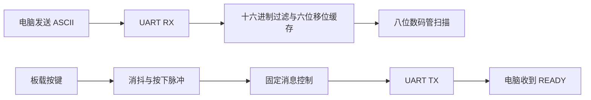

# FPGA Serial Workbench

用 Verilog 在 Minisys FPGA 上搭建一个串口十六进制监视器。电脑发来的字符在八位数码管上滚动显示，按键触发 FPGA 回发 `READY`。同一套 UART 收发模块还支撑周期消息和关键词识别。仓库包含从组合运算到完整串口系统的六个实践主题。

## 快速开始

仿真需要 Python 3 和 Icarus Verilog。将 `iverilog` 与 `vvp` 加入 `PATH` 后，在仓库根目录运行以下命令。 [Icarus Verilog](https://steveicarus.github.io/iverilog/)

```sh
python scripts/simulate.py
python scripts/simulate.py uart_hex_monitor --vcd
```

第二条命令把波形写入 `build/sim/tb_uart_hex_monitor.vcd`。仿真使用自检 testbench，断言失败会返回非零退出码。

以下命令使用 Vivado 构建监视器，需要安装 Artix-7 器件支持。

```sh
vivado -mode batch -source scripts/build_minisys.tcl -tclargs uart_hex_monitor
```

比特流和报告写入 `build/vivado/uart_hex_monitor/`。板卡连接、串口参数和其他顶层的构建方法见 [Minisys 使用指南](docs/minisys.md)。

## 串口监视器演示

串口设置为 **9600 baud、8 数据位、无校验、1 停止位**，以文本方式依次发送 `12Ab3cD`。八位数码管从左到右显示 `2Ab3Cd07`，左边六位是最新收到的有效十六进制字符，右边两位是累计接收计数。按一下 S3，串口终端收到 `READY` 和回车换行。



## 设计索引

| 实践主题 | 可构建顶层 | 实现 |
| --- | --- | --- |
| 组合运算 | [`add_sub_mux`](rtl/basics/add_sub_mux.v) | 4 位加减选择与使能 |
| 数据存储 | [`dff`](rtl/basics/dff.v)、[`reg8file`](rtl/basics/reg8file.v) | 带使能的 D 触发器和 8×8 寄存器组 |
| 计数与移位 | [`led_chaser`](rtl/basics/led_chaser.v) | 四档速度、按键启停、双向循环移位 |
| 显示扫描 | [`display_demo`](rtl/apps/display_demo.v) | 原始按键与消抖计数对比、0–30 定时计数 |
| UART 发送 | [`uart_beacon`](rtl/apps/uart_beacon.v) | 8N1 发送状态机与周期消息 |
| 串口综合应用 | [`uart_hex_monitor`](rtl/apps/uart_hex_monitor.v)、[`uart_keyword_console`](rtl/apps/uart_keyword_console.v) | 十六进制监视器及带关键词回复的串口终端 |

共享的 UART、消抖与扫描模块位于 [`rtl/lib/`](rtl/lib/)，八个顶层的引脚约束位于 [`constraints/minisys/`](constraints/minisys/)。[设计与验证说明](docs/design.md) 展开各模块的接口、状态机、定时公式和测试覆盖范围。
