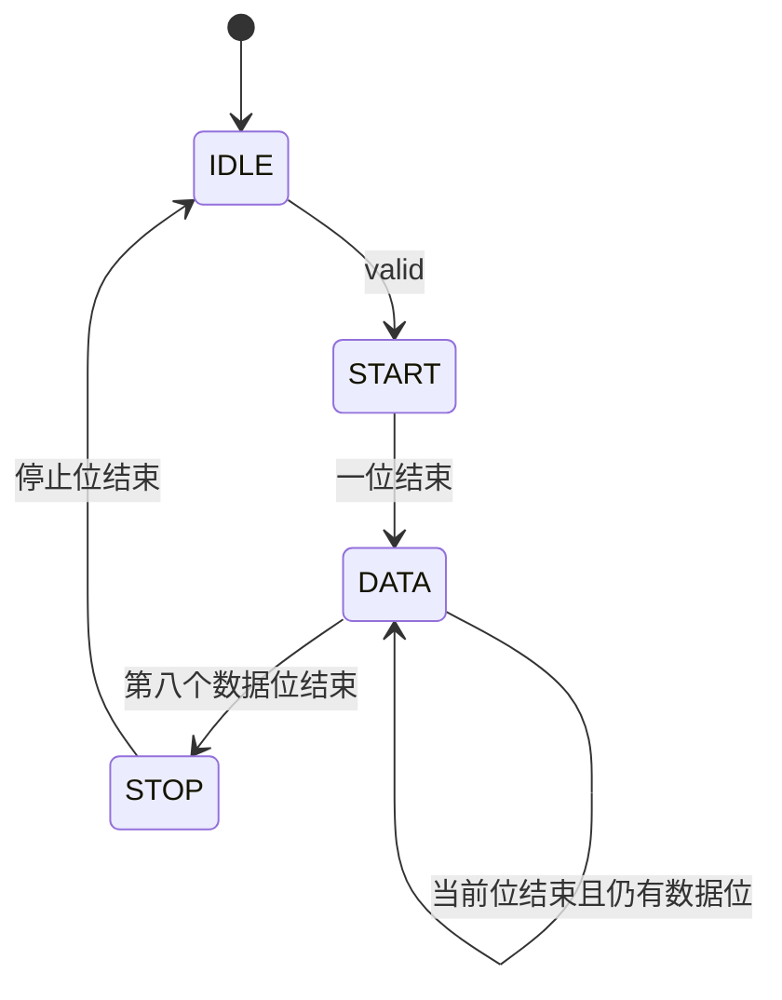

# 设计与验证

## 组合运算与数据存储

`add_sub_mux` 用使能和模式位在两个算术结果之间选择。`output_c` 只有 4 位，结果按模 16 截断。例如 `15 + 2 = 1`，`0 - 1 = 15`。

| `en` | `mux_sel` | `output_c` |
| --- | --- | --- |
| 0 | 任意 | `4'hf` |
| 1 | 0 | `input_a + input_b` 的低 4 位 |
| 1 | 1 | `input_a - input_b` 的低 4 位 |

`dff` 在上升沿且 `en=1` 时保存 `d`。`reg8file` 用同样的时序写入 `registers[wsel]`，读取端则是组合选择器，改变 `rsel` 后 `q` 随即更新。两者的高有效 `clr` 都能在时钟沿之间清零。阅读波形时，可在时钟下降沿切换输入，观察下一上升沿之后的写入结果。

组合逻辑中的阻塞赋值 `=` 在语句执行时更新值。时钟块中的非阻塞赋值 `<=` 先采样右侧，再安排寄存器同时更新。多级同步器依靠这一点，让后一级在当前时钟沿使用前一级的旧值。

## LED 流水灯

复位后仅 LED0 点亮，计数器等待 `button` 的上升沿。按键经过两级同步和边沿检测，单次上升沿翻转启停状态。`elapsed` 从 0 数到 `interval-1`，计数结束时触发一次循环移位。`dir_set=1` 向高位移，`dir_set=0` 向低位移。换档和重新启动时从零计时，暂停期间保留灯的当前位置。该示例的机械按键可能因抖动产生多个上升沿，显示示例演示如何消抖。

| `freq_set` | 每步时钟周期数 | 100 MHz 下每步时间 |
| --- | ---: | ---: |
| `00` | 100 000 | 1 ms |
| `01` | 1 000 000 | 10 ms |
| `10` | 5 000 000 | 50 ms |
| `11` | 20 000 000 | 200 ms |

## 消抖与数码管

`button_debounce` 先将按键同步到 `clk`，再测量新电平持续的时间。输入连续稳定 `STABLE_CYCLES` 个时钟才更新稳定电平。稳定电平从 0 变成 1 的一拍内输出 `pressed`，长按只产生一个脉冲。

`display_demo` 将同一个按键的同步原始边沿和消抖后的按下脉冲并排显示。每一组都是两位，左到右依次为演示编号 `42`、原始计数、消抖计数、定时计数。前两组计数模 100，定时计数每 0.1 s 加一并在 30 后回到 0。`run_button` 控制定时计数启停，`display_en=0` 时数码管熄灭，计数继续。

`sevenseg_scan` 每隔 `SCAN_CYCLES` 拍选择下一位。`digits[4*i +: 4]` 对应 `sel[i]`，第 0 位在最右边。`visible[i]=0` 时对应时隙关闭该位和全部段。默认每 125 µs 换位，每 1 ms 完成一轮。`seg[7:0]` 按 `{dp,g,f,e,d,c,b,a}` 排列，段选与位选均为低有效，小数点始终熄灭。

## UART 链路

每个 8N1 字节依次发送低电平起始位、8 个从低位到高位的数据位、高电平停止位。整数分频 `BIT_CYCLES = CLK_HZ / BAUD_RATE` 在 100 MHz、9600 baud 下取 10 416 拍，每位约 104.16 µs。修改参数时采用正值，并保证 `BIT_CYCLES >= 8`，给接收同步和采样留出余量。

发送端在采到 `valid=1` 且 `busy=0` 的上升沿锁存一个字节。`busy` 覆盖整个帧，`tx` 在位边界更新。接收端用两级寄存器同步 `rx`，在半个位时长后确认起始位，随后每隔一位采样一次。停止位采到高电平时数据有效，`valid` 为单周期脉冲。停止位异常时，接收器等待线路重新变高，再继续接收。

`uart_message` 使用 `busy` 作为背压逐字节发送固定消息，末字节的停止位发完才退出活动状态。`uart_beacon` 每次完成 `HELLO FPGA` 和 CRLF 后等待至少 0.2 s，再发送下一行。`uart_hex_monitor` 在消抖按下事件到来时发出 `READY` 和 CRLF。发送期间的其他按下事件会被丢弃，接收逻辑仍可更新显示。

## 串口应用层

### 十六进制显示

`hex_history` 接收 ASCII `0–9`、`A–F` 或 `a–f`，将其转换为 4 位数值存入六位滚动窗口。新字符靠右，最旧字符移出左端，未填满的高位熄灭。有效字符累计值取模 100，右端两位在 `99` 后回到 `00`。其余字符不会更新显示或计数。七段字形中的 B、D 分别显示为 `b` 和 `d`。

| 发送文本 | 左侧 6 位 | 右侧 2 位 |
| --- | --- | --- |
| 复位后 | 6 位空白 | `00` |
| `1x` | 5 位空白 + `1` | `01` |
| 接着发送 `2Ab3cD` | `2Ab3Cd` | `07` |

### 关键词回复

`keyword_matcher` 用三个并行的前缀状态机逐字节识别关键词，ASCII 大写字母先转为小写。匹配的是子串，例如 `xxSTOPyy` 会匹配 `stop`。同一行内最后匹配的关键词决定回复。

| 关键词 | 回复的单个 ASCII 字节 |
| --- | --- |
| `start` | `1` |
| `stop` | `2` |
| `fpga` | `3` |
| 无匹配 | `0` |

CR、LF 都能结束一行。连续的 CR/LF 只触发一次回复，新正文解除锁定。每次回复后清空前缀状态与最近匹配值，所以 `sta` 和 `rt` 分两行发送不会构成一次匹配。回复字节本身不附带换行。

## 仿真覆盖

除 `uart_core` 按默认 100 MHz/9600 baud 检查位时长外，其他较慢的逻辑通过参数缩小分频和消抖周期。UART 应用测试直接驱动串口引脚并在位中点解码回复。调试时可加 `--vcd` 生成可用波形。

| 仿真用例 | 自检内容 |
| --- | --- |
| `add_sub_mux` | 穷举 1 024 组输入 |
| `dff`、`reg8file` | 异步清零、写使能、保持与异步读 |
| `led_chaser` | 启停、回绕、双向移位、运行中换档 |
| `display_demo` | 八位扫描、消抖前后边沿差异、定时器启停 |
| `uart_core` | 位边界、数据锁存、背靠背帧、短毛刺、坏停止位恢复 |
| `uart_beacon` | 周期发送的字节顺序与消息间隔 |
| `uart_hex_monitor` | 串口接收过滤、滚动显示、消隐、99 回零、长按与再次按下 |
| `uart_keyword_console` | 大小写、子串、连续行、CRLF 去重、最后一次匹配 |
